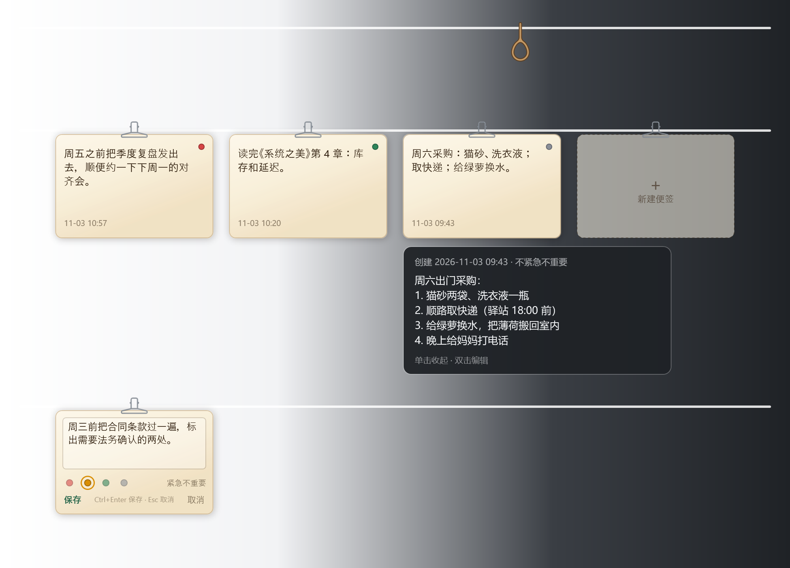
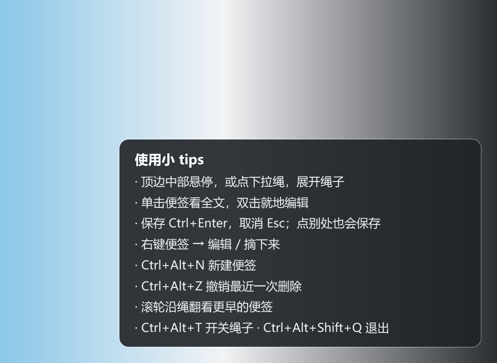
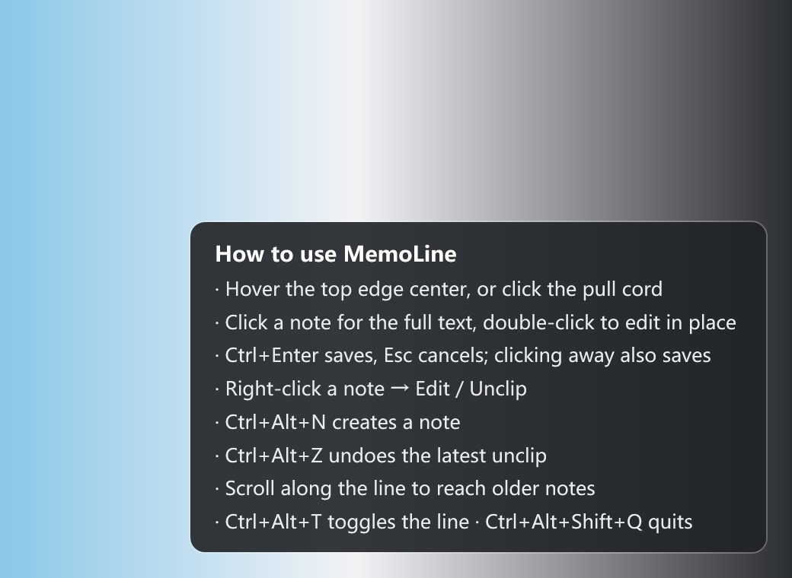

<div align="center">

<h1>MemoLine · 备忘录晾衣绳</h1>

<p><strong>Notes, hung on a line.</strong></p>

<p>把待办和提醒写在便签上，夹到屏幕顶边的一根绳子上。需要时把鼠标顶到上边缘，用完移开，桌面什么都不留。</p>

<p>Windows 10/11 · .NET 10 · 单文件免安装 · 零网络 · 数据只在本机</p>

<p><a href="#中文">中文</a> · <a href="#english">English</a></p>

</div>



## 中文

### 这是什么

MemoLine 是一个很小的 Windows 桌面工具：它把便签挂在你屏幕顶边的一根绳子上。

鼠标移到屏幕上边缘中间三分之一，绳子垂下来，便签一张张挂在夹子上；鼠标移开，绳子收起，桌面恢复原样。它不占窗口、不占任务栏，也不往桌面上堆东西。

它和剪贴板工具 Clipline 共用同一套“顶边晾衣绳”的交互方式，但不碰剪贴板：每张便签都由你亲手写下、亲手修改、亲手摘掉。

### 为什么会有它

剪贴板晾衣绳回答“我刚才复制了什么”；MemoLine 回答“我接下来要做什么”。

待办常常散在聊天记录、便利贴和脑子里。MemoLine 把它们集中到一条随手可及、又不会一直碍眼的绳子上。

### 特性

- **顶边呼出，自动收起**：鼠标到屏幕上边缘中间，绳子垂下；移开约 0.2 秒自动收起，桌面不留痕。
- **挂上和摘下都有动效**：新便签从下往上挂到夹子上，删除时向下落出并淡出；夹子始终不动，只有便签在动。
- **四象限分类**：紧急且重要、紧急不重要、重要不紧急、不紧急不重要，对应红、橙、绿、灰四个色点，便签上直接可见。
- **就地编辑**：双击便签变成输入框，`Ctrl+Enter` 保存，`Esc` 取消；创建时间保留，另记更新时间。
- **不抢焦点**：呼出、浏览、增删都不改变前台窗口；只有双击编辑时临时取得焦点，保存或取消后立即归还。
- **数据只在本机**：便签保存在本地 JSON 文件里，退出程序或重启电脑都不会丢。
- **免安装单文件**：一个 `MemoLine.exe` 即可运行，自带 .NET 运行时；托盘菜单随时退出。
- **中英双语**：托盘菜单可切换界面语言。
- **零网络、零遥测**：没有账号、没有同步、没有网络请求，也不读取剪贴板。

### 怎么用

| 操作 | 方式 |
|---|---|
| 呼出 / 收起 | 鼠标移到屏幕上边缘中间三分之一；移开自动收起 |
| 新建便签 | 点击绳尾的空夹子；或托盘菜单“新建便签”；或 `Ctrl+Alt+N` |
| 查看全文 | 单击便签，展开预览；再次单击或移开恢复 |
| 编辑 | 双击便签，就地编辑；`Ctrl+Enter` 保存，`Esc` 取消 |
| 删除 | 右键便签 → “摘下来”；`Ctrl+Alt+Z` 撤销最近一次删除 |
| 展开 / 收起绳子 | `Ctrl+Alt+T` |
| 显示 / 隐藏绳头 | `Ctrl+Alt+L` |
| 退出 | 托盘菜单 → 退出；或 `Ctrl+Alt+Shift+Q` |

右键便签也可以直接进入编辑或删除；托盘菜单包含全部操作，快捷键被其他程序占用时也能正常使用。



### 安装

1. 下载或构建 `MemoLine.exe`；如果仓库暂时没有 Release，请按下方“从源码构建”生成。
2. 双击运行，不需要安装，也不需要单独安装 .NET 运行时（发布版为自包含单文件）。
3. 从托盘菜单退出。

程序目前没有代码签名，Windows SmartScreen 可能提示“未知发布者”；选择“更多信息 → 仍要运行”即可。系统要求 Windows 10/11 x64。

### 数据与隐私

便签保存在：

```
%LOCALAPPDATA%\MemoLine\notes.json
```

- 退出程序、重启电脑都不会清空。
- 写入采用临时文件 + 原子替换；JSON 损坏时原文件会被改名备份，不会静默删除。
- 删除 `%LOCALAPPDATA%\MemoLine` 文件夹即可清空全部数据。
- 程序不联网、不读剪贴板、不写注册表、不注册开机自启，也没有遥测。

### 从源码构建

需要 .NET 10 SDK：

```powershell
dotnet build -c Debug
dotnet run -c Debug -- --selftest   # 自动化自检，退出码 0 表示通过
dotnet run -c Debug                  # 正常启动
```

打包便携单文件：

```powershell
dotnet publish -c Release -r win-x64 --self-contained true -p:PublishSingleFile=true -p:IncludeNativeLibrariesForSelfExtract=true -p:DebugType=None -p:DebugSymbols=false -o dist/MemoLine-win-x64
```

日志写在 `%TEMP%\memoline.log`。

### 已知限制

- 目前只支持 Windows。
- 以主显示器为主，多显示器支持还在后续计划里。
- 便签是纯文本，不支持图片、附件或富文本。
- 删除通过右键菜单完成，“把便签拖离绳子删除”尚未实现。
- 有意不做云同步、账号和提醒推送。

### 参与贡献

欢迎提 Issue 和 PR。这个项目的边界比较明确：不联网、不碰剪贴板、不抢焦点、数据只留在本机；改动请尽量保持这些约束。

### 许可证

[MIT](LICENSE)。

---

## English

### What is MemoLine?

MemoLine is a tiny Windows app that hangs your notes on a clothesline at the top edge of the screen.

Move the pointer to the middle third of the top edge and the line drops down, with your notes clipped along it. Move away and the line retracts, leaving the desktop exactly as it was. There is no window to manage and nothing sitting in the taskbar.

It shares the “clothesline at the top edge” interaction model with Clipline, a clipboard tool, but it never touches the clipboard: every note is written, edited and removed by you.


### Why another notes app?

Clipline answers “what did I just copy?”. MemoLine answers “what do I need to do next?”.

Todos tend to scatter across chat threads, sticky notes and memory. MemoLine keeps them on one line that is always a gesture away, yet never in the way.

### Features

- **Drop-down line**: move to the middle of the top edge to reveal it; move away and it retracts after about 0.2 seconds.
- **Animated hanging and removal**: a new note rises onto its clip; deleting one drops it down and fades it out. The clips never move — only the paper does.
- **Four-quadrant categories**: urgent & important, urgent but not important, important but not urgent, and neither — shown as red, orange, green and grey dots on each note.
- **Edit in place**: double-click a note, press `Ctrl+Enter` to save or `Esc` to cancel. The creation time is preserved and the update time is recorded separately.
- **No focus stealing**: revealing, browsing and adding/removing notes leave the foreground window alone. Only explicit editing takes focus temporarily and returns it when you save or cancel.
- **Local-only data**: notes live in a JSON file on your machine and survive restarts.
- **Portable single file**: one `MemoLine.exe`, no installer, no separate .NET runtime; quit from the tray.
- **Chinese and English UI**, switchable from the tray menu.
- **No network, no telemetry**: no accounts, no sync, no network requests, and no clipboard access.

### Usage

| Action | How |
|---|---|
| Reveal / retract | Move the pointer to the middle third of the top edge; move away to retract |
| New note | Click the empty clip at the end of the line, use the tray menu, or press `Ctrl+Alt+N` |
| Read full text | Single-click a note; click again or move away to close |
| Edit | Double-click a note; `Ctrl+Enter` to save, `Esc` to cancel |
| Delete | Right-click a note → “Take it down”; `Ctrl+Alt+Z` undoes the last deletion |
| Reveal / retract line | `Ctrl+Alt+T` |
| Show / hide pull cord | `Ctrl+Alt+L` |
| Quit | Tray menu → Quit, or `Ctrl+Alt+Shift+Q` |

Right-clicking a note also offers Edit and Take it down. The tray menu exposes every action, so the app remains usable if another program owns the hotkeys.



### Install

1. Download or build `MemoLine.exe`; if no release is available yet, build it from source below.
2. Double-click to run. No installation and no separate .NET runtime are required for the self-contained release.
3. Quit from the tray menu.

The binary is currently unsigned, so Windows SmartScreen may show an “Unknown publisher” warning. Choose “More info → Run anyway”. Requires Windows 10/11 x64.

### Data and privacy

Notes are stored at:

```
%LOCALAPPDATA%\MemoLine\notes.json
```

- Quitting the app or restarting Windows does not clear them.
- Writes use a temporary file and an atomic replace; a corrupt JSON file is renamed and backed up instead of being silently deleted.
- Delete the `%LOCALAPPDATA%\MemoLine` folder to clear all data.
- The app makes no network requests, does not read the clipboard, does not write the registry, does not register itself to start with Windows, and collects no telemetry.

### Build from source

Requires the .NET 10 SDK:

```powershell
dotnet build -c Debug
dotnet run -c Debug -- --selftest   # automated checks; exit code 0 means pass
dotnet run -c Debug                  # launch normally
```

Publish a portable single file:

```powershell
dotnet publish -c Release -r win-x64 --self-contained true -p:PublishSingleFile=true -p:IncludeNativeLibrariesForSelfExtract=true -p:DebugType=None -p:DebugSymbols=false -o dist/MemoLine-win-x64
```

Logs are written to `%TEMP%\memoline.log`.

### Known limitations

- Windows only.
- Primarily designed around the primary monitor; multi-monitor support is planned.
- Notes are plain text — no images, attachments or rich text.
- Deletion is via the context menu; dragging a note off the line to delete it is not implemented yet.
- No cloud sync, accounts or reminder notifications, by design.

### Contributing

Issues and pull requests are welcome. The project has a deliberately narrow scope: no network, no clipboard access, no focus stealing, and local-only data. Please keep changes within those boundaries.

### License

[MIT](LICENSE).
